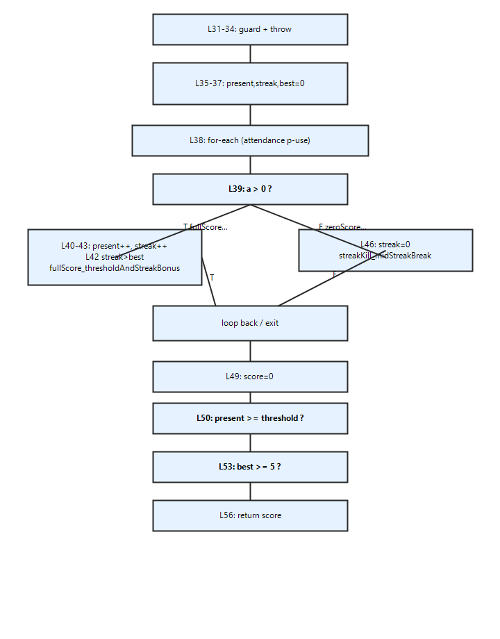

# Лаборатори 10 — Definition-Use хосууд (DataFlow)

**Нэр:** Түмэннасан Мөнхцэцэн  
**Оюутны код:** *B232270025*  

## Хэсэг A — `gcd` DU хосууд

Файлын мөр (`DataFlowTargets.java`): def `x`,`y` — **13**; `while` **15**; `tmp` **16**; `x` **17**; `y` **18**; `return` **20**.

| Хувьсагч | Def мөр | Use мөр | Төрөл | Def-clear зам | Тест ID | Хамрагдсан |
|---------|---------|---------|-------|---------------|---------|------------|
| x | 13 | 16 | c-use | 13→15(T)→16 | `gcd_oneIteration`, `gcd_multipleIterations` | тийм |
| x | 13 | 20 | c-use | 13→15(F)→20 | `gcd_noLoop_yZero` | тийм |
| x | 17 | 16 | c-use | 17→18→15(T)→16 | `gcd_multipleIterations` | тийм |
| x | 17 | 20 | c-use | 17→18→15(F)→20 | `gcd_multipleIterations` | тийм |
| y | 13 | 15 | p-use | 13→15 | `gcd_noLoop_yZero`, бусад тест | тийм |
| y | 13 | 16 | c-use | 13→15(T)→16 | `gcd_oneIteration` | тийм |
| y | 18 | 15 | p-use | 18→15 | `gcd_multipleIterations` | тийм |
| y | 18 | 16 | c-use | 18→15(T)→16 | `gcd_multipleIterations` | тийм |
| tmp | 16 | 18 | c-use | 16→17→18 | `gcd_oneIteration`, `gcd_multipleIterations` | тийм |

**Лекцэд дутуу байсан хос:** `y (18,16)` — давталтын дараагийн эргэн тойрогт `y`-ийн шинэ def-ийг `x % y` дээр c-use хийдэг.

### Тестүүд (`GcdTest.java`)

`mvn test -Dtest=GcdTest` → **Tests run: 4, Failures: 0**.

| Тест | Хамарсан DU хос (файлын мөр) |
|------|------------------------------|
| `gcd_noLoop_yZero` | x(13,20), y(13,15) |
| `gcd_oneIteration` | x(13,16), y(13,16), tmp(16,18) |
| `gcd_multipleIterations` | x(17,16), x(17,20), y(18,15), y(18,16), tmp(16,18) |
| `gcd_zeroX_entersLoop` | x(13,16) (`x=0` үеийн c-use) |

- `gcd(7,0)` дангаараа **x(13,20)** хосыг (давталтгүй) хамарна.
- `gcd(12,8)` **2 удаа** давталт хийж **x(17,·)**, **y(18,·)** хосуудыг хамарна.

---

## Хэсэг B — `bonus`

### B1 — CFG

For-each (мөр 38): нөхцөл — `attendance` дараагийн элементтэй эсэх (attendance p-use); алхам — дараагийн элементийг `a`-д оноох (`a` def).

### B2 — Def / Use (товч)

| Мөр | Def | Use |
|-----|-----|-----|
| 31 | attendance, threshold | — |
| 32 | — | p-use attendance, threshold |
| 35–37 | present, streak, best | c-use present (40), p-use streak (42), p-use best (42) |
| 38 | a | p-use attendance, p-use a (39) |
| 40 | present | c-use present |
| 41 | streak | c-use streak (41), p-use (42) |
| 43 | best | p-use best (42, 53) |
| 46 | streak (kill) | — streak өмнөх def-үүдийг **алдана** (L41) |
| 49, 51, 54 | score | c-use score (54), return (56) |
| 50 | — | p-use present |
| 53 | — | p-use best |

### B3 — DU хүснэгт (гол хосууд)

Kill: **мөр 46** `streak = 0` нь streak-ийн өмнөх def (ж: L41)-ийг устгана; kill-ийн дараа хуучин def-аас use руу def-clear замгүй тул DU хос тооцохгүй.

| Хувьсагч | Def | Use | Төрөл | Kill / тэмдэглэл | Тест ID |
|---------|-----|-----|-------|------------------|---------|
| attendance | 31 | 32 | p-use | — | `invalid_nullAttendance` |
| attendance | 31 | 38 | p-use | for-each | `fullScore_thresholdAndStreakBonus` |
| threshold | 31 | 32 | p-use | — | `invalid_nullAttendance` |
| threshold | 31 | 50 | p-use | — | `fullScore_...`, `edge_empty_...` |
| present | 35 | 40 | c-use | — | `fullScore_...` |
| present | 40 | 50 | p-use | loop | `streakKill_...` |
| streak | 36 | 41 | c-use | — | `fullScore_...` |
| streak | 41 | 42 | p-use | — | *(all-DU-pairs шат)* |
| streak | 46 | 42 | p-use | **kill** | `streakKill_midStreakBreak` |
| best | 37 | 43 | def→use дотоод | — | `fullScore_...` |
| best | 43 | 53 | p-use | — | *(all-DU-pairs шат)* |
| a | 38 | 39 | p-use | — | `fullScore_...` |
| score | 49 | 56 | c-use | return | `zeroScore_allAbsent` |
| score | 51 | 54 | c-use | — | `fullScore_...` |
| score | 54 | 56 | c-use | — | `fullScore_...` |

**Биелэшгүй хос (жишээ):** def L41 → “use” L46 — L46 нь use биш, шинэ def (kill).

### B4 — All-definitions тестүүд

**Яагаад 5 тест вэ?** `score` гурван def (L49, L51, L54) нэг гүйцэтгэлд use (return, L54) хүргэхгүй; streak kill (L46) өөр case; null/хоосон array тусдаа. Ингэснээр **5-аас бага болохгүй**.

`mvn test -Dtest=GcdTest,BonusTest$AllDefinitions` → **Tests run: 9, Failures: 0** (`results/mvn-verify-alldefs.txt`).

| Тест ID | Def-үүдийг хамарна |
|---------|-------------------|
| `fullScore_thresholdAndStreakBonus` | attendance, a, present, streak, best, score L51/L54 |
| `zeroScore_allAbsent` | present, score L49→return |
| `streakKill_midStreakBreak` | streak L46 kill |
| `invalid_nullAttendance` | attendance/threshold p-use L32 |
| `edge_empty_thresholdZero` | for-each 0 удаа, threshold L50 |

### B5 — JaCoCo (all-defs шат)

`results/jacoco-alldefs.csv`: **BRANCH_MISSED=1**, BRANCH_COVERED=15; LINE_MISSED=1 (далд конструктор).

All-defs хангагдсан ч branch 100% биш — нэг predicate салаа (ж: `streak > best` F эсвэл `best >= 5` F) all-DU-pairs тестээр нөхөнө.